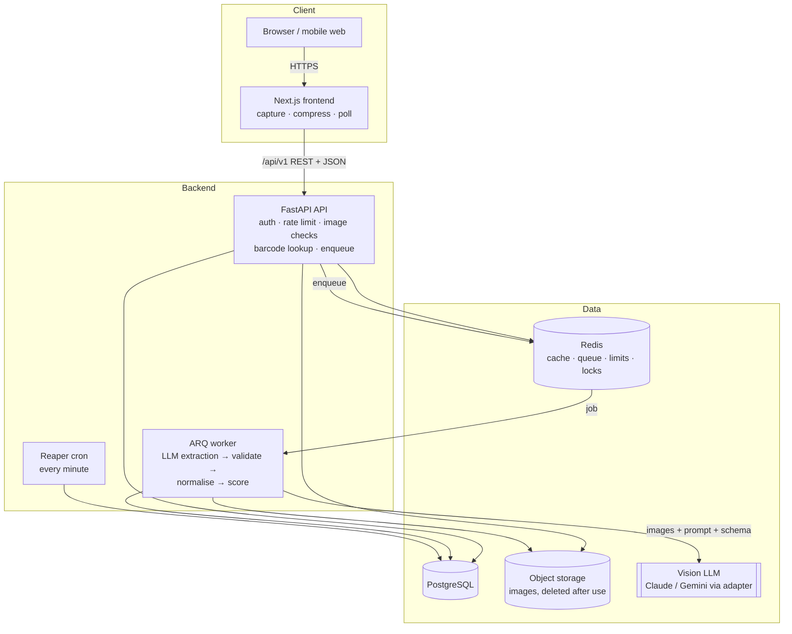
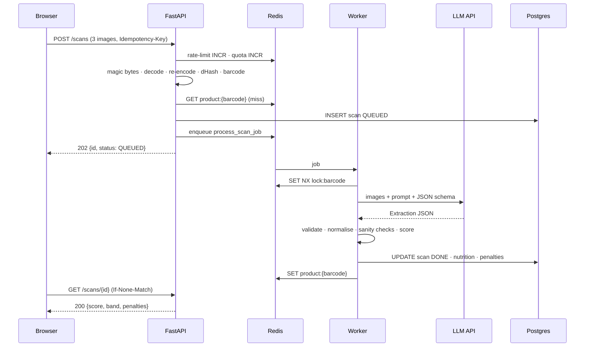
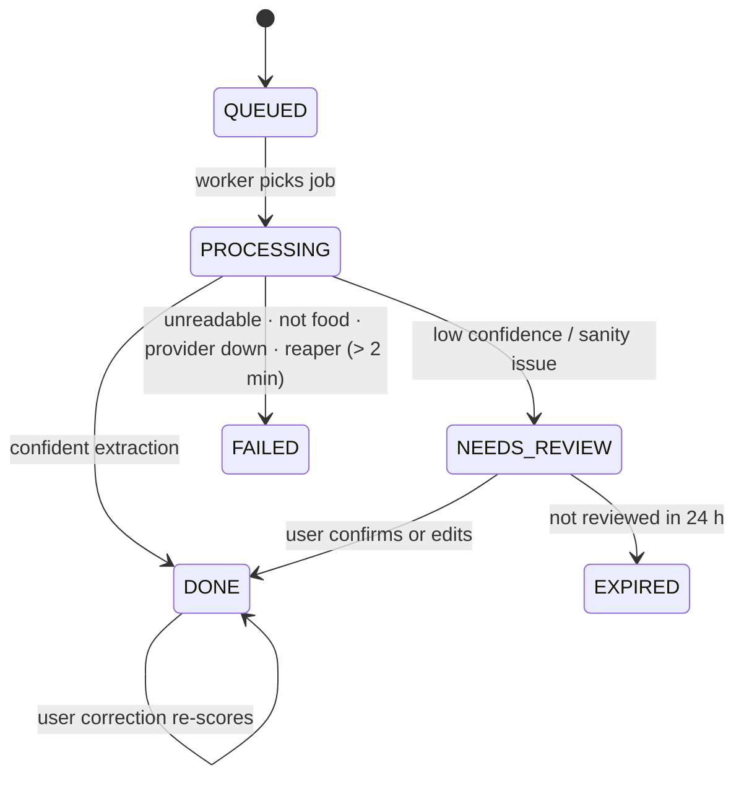
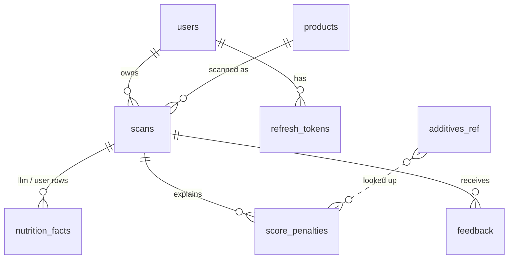

# Architecture

FoodScore uses a classic **API + background worker** pattern. The browser only talks to the
Next.js origin; `/api/*` is proxied to FastAPI, so AI keys never reach the client and the
refresh-token cookie stays first-party.

## Request flow — new product

A repeat scan of a cached barcode returns **200** from the API directly (no queue, no LLM).

## Scan state machine

## Components

| Component | Code | Responsibility |
|---|---|---|
| Frontend | `frontend/app`, `frontend/components` | Guided capture, client-side image prep, upload with progress, polling, result/review/history |
| API | `backend/app/api/v1` | Auth, rate limits, quotas, image security, barcode, idempotency, job creation, results |
| Pipeline | `backend/app/services/pipeline.py` | Worker job: extract → validate → normalise → score → persist → cache → delete images |
| Extraction | `backend/app/services/extraction` | Provider adapters, prompt loading, retries, circuit breaker, fallback |
| Normalisation | `backend/app/services/normalise` | Label-text parsing, unit/basis conversion, sanity checks, review decision |
| Scoring engine | `backend/app/services/scoring` | Pure functions: thresholds, additives, ingredient rules, NOVA, caps, bands |
| Workers | `backend/app/workers` | ARQ settings, job entry point, reaper cron |
| Data | `backend/app/db` | SQLAlchemy 2 models, Alembic migrations, additive seed |

## Data model

Indexes: `products(barcode)` unique, `products(fingerprint)` unique, `scans(user_id, created_at)`
for history, `scans(idempotency_key)` unique, GIN trigram on `products(name)` (Postgres).
`ON DELETE CASCADE` from `users` makes account deletion remove all personal data.

## Failure policy

| Dependency down | Behaviour |
|---|---|
| LLM provider | Retries with backoff → fallback provider → scan FAILED with a 503-style problem, quota kept |
| Redis — cache | Skipped (fail open) |
| Redis — rate limits | In-process counters |
| Redis — queue | `POST /scans` returns 503 + `Retry-After`, images deleted, quota refunded |
| Worker | Job retried by ARQ; reaper marks stuck scans FAILED after 2 min |
| Postgres | `/ready` returns 503 so the platform stops routing traffic |

## Observability

- **Logs:** structlog JSON with `request_id` (propagated via `X-Request-ID`), hashed user id,
  `scan_id`, duration. Passwords, tokens and image bytes are redacted.
- **Metrics** (`/metrics`, Prometheus): scans by status, cache hits/misses, LLM latency
  histogram, LLM cost, extraction failures, user corrections per field.
- **Errors:** Sentry when `SENTRY_DSN` is set (`send_default_pii=False`).
- **Suggested alerts:** failure rate > 10 % over 15 min; `llm_budget_alarm` log events;
  queue depth > 50.

See `docs/adr/` for the reasoning behind each design decision.
